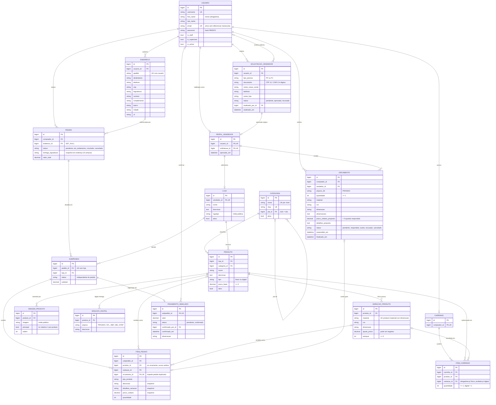

# Diagrama entidade-relacionamento

Reflete os models implementados em `apps/*/models.py` e as migrações `0001_initial` de cada app.
Os nomes de tabela no SQLite seguem o padrão do Django (`<app>_<modelo>`, ex.: `catalogo_produto`).

Legenda de cardinalidade (Mermaid): `||` exatamente um · `|o` zero ou um · `o{` zero ou muitos.

## Políticas de exclusão (`on_delete`)

| Relação | Política | Motivo |
|---|---|---|
| Pedido → comprador, SubPedido → loja, ItemPedido → produto/variação/orçamento | `PROTECT` | Histórico comercial não pode sumir em cascata. |
| Produto → loja/categoria, Categoria → pai, Loja → vendedor, Perfil → usuário/solicitação | `PROTECT` | Exclusão acidental de dados de catálogo e cadastro. |
| Pedido → endereço | `SET_NULL` | O endereço usado fica copiado no pedido (snapshot). |
| Variação/Imagem/Arquivo → produto, Itens → carrinho/subpedido, SubPedido → pedido | `CASCADE` | Partes que só existem dentro do agregado; o admin não permite excluir pedidos. |
| Endereço/Carrinho → usuário | `CASCADE` | Dados pessoais do próprio usuário (usuários com pedidos já são protegidos). |

## Restrições no banco (CHECK/UNIQUE)

- Estados válidos em `status` de solicitação, orçamento, pedido, subpedido e pagamento.
- `SolicitacaoVendedor`: documento compatível com o tipo (11/14 dígitos); análise registra quem/quando; no máximo uma solicitação pendente/aprovada por usuário e por CPF/CNPJ.
- `Categoria`: não é pai de si mesma; nome único por nível (inclusive raízes). Ciclos indiretos são barrados em `clean()`.
- `Produto`: preço base ≥ 0. `VariacaoProduto`: estoque ≥ 0 e combinação material/cor/dimensão única (sem diferenciar maiúsculas). Preço final ≥ 0 validado em `clean()`.
- `ImagemProduto`: no máximo uma imagem principal por produto (índice único parcial).
- `ItemCarrinho`: quantidade ≥ 1; sem itens repetidos (produto/variação).
- `ItemPedido`: origem é produto **ou** orçamento; variação só com produto; digital com quantidade 1 e sem variação.
- `Orcamento`: pendente sem proposta; respondido/aceito/recusado com proposta; preço > 0.
- `SubPedido`: um por loja em cada pedido. `PagamentoSimulado`: confirmado ⇔ quem e quando.
